# Key findings

Generative AI has set off a building programme in data centres, and this note asks how an investor should hold it. We split seventeen listed companies into three clusters: the landlords that own and lease data centres (five US REITs), two operators in China, and ten suppliers of the power, cooling and networking equipment the buildings need. We then build portfolios from them with two methods, test those portfolios on data they never saw, and project them ten years ahead.

**Our view.** The thesis survives in a narrower form than the first version claimed. The theme was real and the infrastructure names delivered it. What the optimiser adds on top of a simple equal-weighted basket is small and, on the evidence available, cannot be distinguished from luck.

Key numbers

<table>
<tr><td>$100 in the infrastructure suppliers, Mar 2020 to Sep 2026</td><td>$750, against $283 in the S&amp;P 500</td></tr>
<tr><td>Black-Litterman portfolio, 15% position cap</td><td>13 names, effective number of positions 10.1</td></tr>
<tr><td>$500,000 out of sample, Jan 2025 to Sep 2026</td><td>$778k Black-Litterman, $763k equal weight, $663k S&amp;P 500</td></tr>
<tr><td>Out-of-sample Sharpe ratio, 95% interval</td><td>Black-Litterman 0.93 (−0.57 to 2.44), S&amp;P 500 1.04</td></tr>
<tr><td>Volatility, forecast against realised</td><td>Black-Litterman 22% vs 26.5%; historical mean 25% vs 40%</td></tr>
<tr><td>Ten years ahead on Black-Litterman views, today's money</td><td>Median $822k from $500k; 15% chance of a nominal loss</td></tr>
</table>

The main findings:

* The infrastructure suppliers carried the theme, returning 36% a year from March 2020 to September 2026 against 17% for the S&P 500. The REITs returned 9% a year, and the Chinese operators lost about half their value.
* Optimising on historical average returns produces a portfolio that looks excellent on the data it was fitted to and concentrates in whatever went up most. Black-Litterman, which anchors expected returns to market capitalisation, gives a more diversified portfolio with modest expectations.
* Out of sample, from January 2025 to September 2026, no portfolio can be told apart from the market on a risk-adjusted basis. Every Sharpe ratio has a 95% interval of about ±1.5. Black-Litterman ended level with an equally weighted portfolio of the same stocks.
* Where 21 months can decide something, it is risk. Black-Litterman expected 22% volatility and got 26.5%. The historical-mean portfolio expected 25% and got 40%.
* In a ten-year simulation the expected-return assumption decides almost everything. The same portfolio has a 0% or a 46% chance of losing money depending on that one input. Fat tails barely move the ten-year numbers.

**What has changed.** This rebuilds a note first written in August 2025 and revised in March 2026, which took its numbers from Portfolio Visualizer and reported a 38% expected return with a 0% chance of loss. Everything here is computed from our own code, on one window, from one data snapshot. Appendix D lists the changes.

# 1. The theme and the universe

Training and running large AI models needs far more computing power than ordinary cloud workloads, packed more densely, drawing more electricity and producing more heat. The hyperscalers (Microsoft, Amazon, Alphabet and Meta) have committed very large multi-year capital budgets to new capacity. An investor can take exposure to that spending in three ways.

The first is the landlords: REITs that own data centres and lease space and power to tenants. Equinix and Digital Realty are the two large pure plays. American Tower and Crown Castle are tower REITs with smaller data-centre businesses, and Iron Mountain is a records-storage REIT that has moved into data centres. The second is operators outside the US. Our universe includes the two Chinese operators listed in the US as depositary shares, GDS Holdings and VNET. The third is the suppliers: companies whose equipment goes into every new hall, from power and cooling (Vertiv, Schneider Electric, Eaton, Johnson Controls) to networking (Arista, Cisco, Marvell), building controls (Honeywell) and backup generation (Generac, Caterpillar).

Exhibit 1 lists the universe. Two thematic ETFs serve as the passive alternative an investor could buy instead: DTCR, which holds both REITs and technology names, and SRVR, which holds mostly REITs. The S&P 500, through SPY, is the benchmark. We compare the portfolio with the market, because the question is whether the theme was worth holding instead of the index.

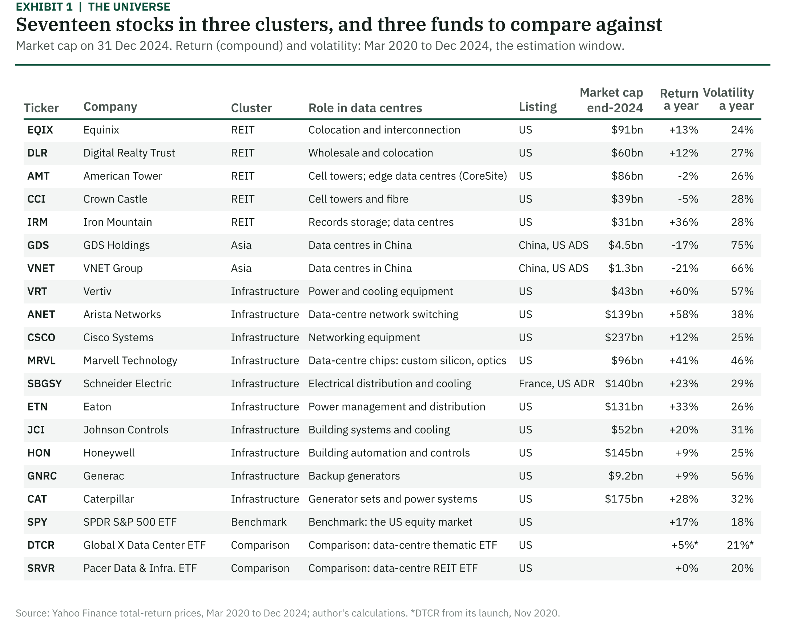

Exhibit 2 shows the three clusters over the whole period, each equally weighted. Most of the theme's return came from the suppliers, at 36% a year. The REITs returned 9% a year, about half the S&P 500's 17%. The Chinese operators lost 90% of their value by February 2024 before recovering part of it. Any portfolio built from these names will be driven by how much weight it puts on the infrastructure cluster.

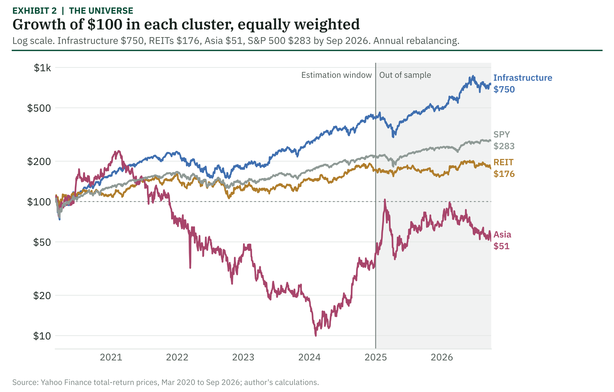

# 2. Approach

**Data.** Daily total-return prices come from Yahoo Finance, adjusted for dividends and splits. The risk-free rate is the monthly one-month Treasury bill rate from the Kenneth French data library, and inflation is US CPI from FRED. Market capitalisations on 31 December 2024 are shares outstanding times the closing price, with the three depositary-share listings converted to the right share units. The snapshot runs to 26 October 2026, and the analysis uses complete months up to 30 September 2026.

**Windows.** All seventeen stocks have clean prices from March 2020, once Vertiv's pre-listing shell history is removed. The estimation window is March 2020 to December 2024, 58 months. The out-of-sample window is January 2025 to September 2026, 21 months. Returns are monthly and simple. Portfolios are rebalanced once a year, on the last trading day of December, and pay 15 basis points on every round trip.

**Covariance.** With seventeen stocks and 58 months, the sample covariance matrix is noisy, and an optimiser leans hardest on exactly its least reliable parts. We use the Ledoit and Wolf (2004) estimator, which pulls the matrix towards a target in which every pair of stocks has the same correlation and each stock keeps its own variance. The data choose how far to pull: here 24% of the way.

**Expected returns.** This is the input that matters most and is estimated worst. We use two methods side by side.

The *historical mean* is each stock's average monthly return over the window, annualised. It is what the first version used.

*Black-Litterman* (Black and Litterman, 1992) starts from a different question: which expected returns would make the market-capitalisation weights of the universe the optimal portfolio? Those implied returns are the prior. They are scaled so that the market-weighted portfolio earns a 5.5% premium over cash, and they are then tilted towards a small number of views, by an amount that depends on how confident each view is. Confidence in each view is set as in He and Litterman (1999), with τ = 1/T. Each view is stated as a tilt beyond what the prior already implies, so a view always pushes in the direction it describes. We hold four views:

| View | Tilt | Reason |
|---|---|---|
| Vertiv against the universe | +4% a year | Power and thermal demand from high-density AI racks |
| Arista against the universe | +3% a year | AI networking build-out |
| Iron Mountain against the universe | +2% a year | Data-centre growth inside a records-storage REIT |
| Equinix against GDS | +6% a year | Chinese regulatory and funding risk at GDS |

The views are deliberately few and modest. Their purpose is to express the thesis without letting it overwhelm the prior.

**Optimisation.** Each method feeds a long-only, fully invested maximum-Sharpe portfolio. We solve it in its convex form, which has a single optimum, so the weights do not depend on starting values. The portfolio caps every position at 15%.

**Reading the exhibits.** The Sharpe ratio is shown twice. The *ex-ante* figure is what the optimiser expected when it chose the weights. The *ex-post* figure is what the portfolio delivered. The gap between them is one of the most useful numbers in the note. Appendix C defines the other measures.

# 3. The portfolio

The portfolio optimises across all seventeen stocks with a 15% cap on each position. The results in this section are in sample: the weights are scored on the data they were fitted to, which flatters every portfolio and the historical-mean portfolio most of all. They show what each method chooses and why. Section 4 shows what happened next.

**Weights.** The historical-mean portfolio fills six positions to the cap (Iron Mountain, Vertiv, Arista, Marvell, Eaton and Caterpillar) and adds 6% in GDS and small positions in Equinix and Digital Realty. Black-Litterman holds thirteen names (Exhibit 3). Iron Mountain and Arista sit at the cap, followed by Cisco at 13%, Vertiv at 10% and Honeywell at 8%. The historical mean puts its money in the past winners. Michaud (1989) called this error maximisation: the optimiser puts the most money where the estimated return is most overstated. Appendix A shows the same pattern inside each cluster.

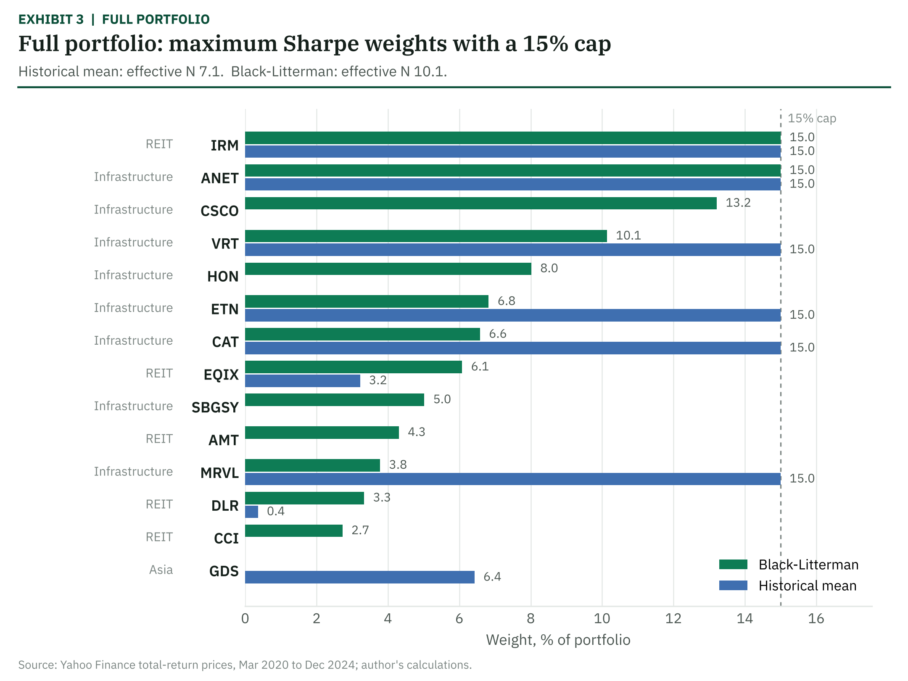

A useful way to compare concentration is the effective number of positions, 1/Σw², the number of equal positions that would be as concentrated as the portfolio. Black-Litterman has 10.1, the historical mean 7.1. The cap sets a floor here. With a 15% limit a portfolio needs at least seven names, and the most concentrated portfolio the cap allows (six positions at 15% and one at 10%) has an effective number of 6.9. The historical-mean portfolio sits just above that floor, so nearly all of its diversification is the cap's doing.

**What the cap does.** Without the cap, Black-Litterman would hold 21% in Arista and 20% in Iron Mountain, the two names its views favour (Exhibit 4). Capping them does not spread the freed weight evenly. It moves to the next-best contributor, Cisco, from 8.5% to 13%. The effective number of positions rises from 7.9 to 10.1. For the historical mean the same cap lifts it from 3.5 to 7.1. A position cap works as a form of shrinkage (Jagannathan and Ma, 2003): it limits how far estimation error can push the weights.

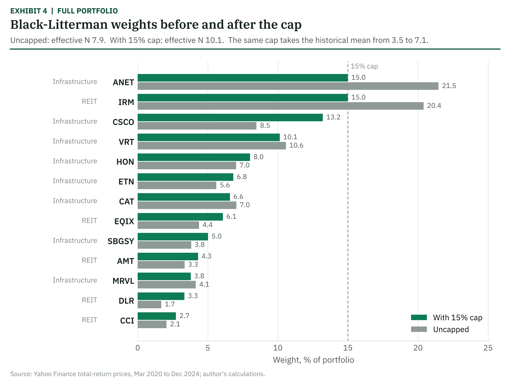

**The prior is weighted by size.** Market capitalisation measures how large a company is. It says nothing about how much of the business is data centres. Cisco, Honeywell and Caterpillar are among the largest names in the universe, so the prior gives them returns that justify large holdings, and without a view on them the optimiser keeps them near their market weights even though data centres are a small part of their revenue. The Black-Litterman portfolio is therefore partly a portfolio of diversified industrials with data-centre exposure. A theme-exposure prior would fix this: weight each company by its market capitalisation times the share of revenue it earns from data centres. That keeps the equilibrium logic while making the neutral portfolio the theme itself. It needs segment revenue from company filings, and we leave it as an extension.

**Cluster mix.** We set no budget per cluster and let the optimiser choose (Exhibit 5). A portfolio manager running this for a client would normally receive a mandate with bands, for example REITs between 20% and 40%, Asia at most 5% and infrastructure between 55% and 75%. Bands like these enter the optimisation as linear constraints on the sum of weights in each cluster. They stay linear in the convex form we use, so the problem keeps a single optimum, and like the position cap they limit the damage estimation error can do. They also encode risks the covariance matrix does not see, such as country and listing risk for the Chinese names. Every band would be a judgement we would have to defend without a client behind it, so we leave the mix free and report it. Black-Litterman moves weight from infrastructure into REITs, 31% against 21% in the market-cap prior, and holds nothing in Asia, without a cluster constraint telling it to.

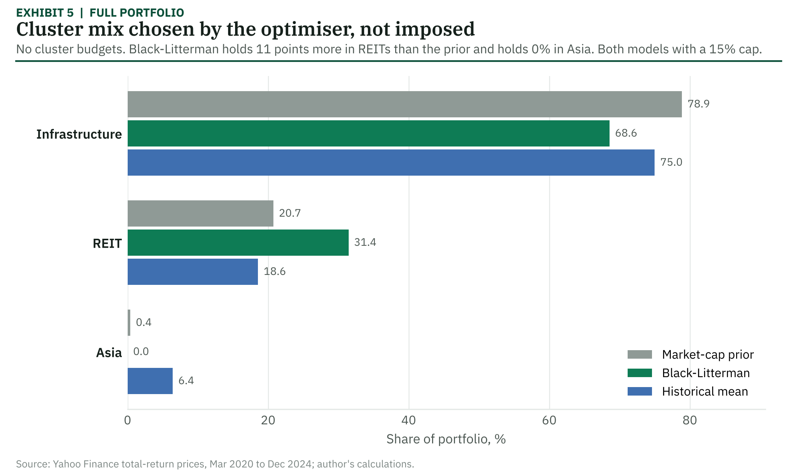

**Two views of the same stocks.** Exhibit 6 shows the efficient frontier each method believes in. On historical means, the best portfolio expects 40% a year. On Black-Litterman, it expects 9%. The two methods look at the same seventeen stocks and the same risk, and they disagree by a factor of more than four on what to expect from them.

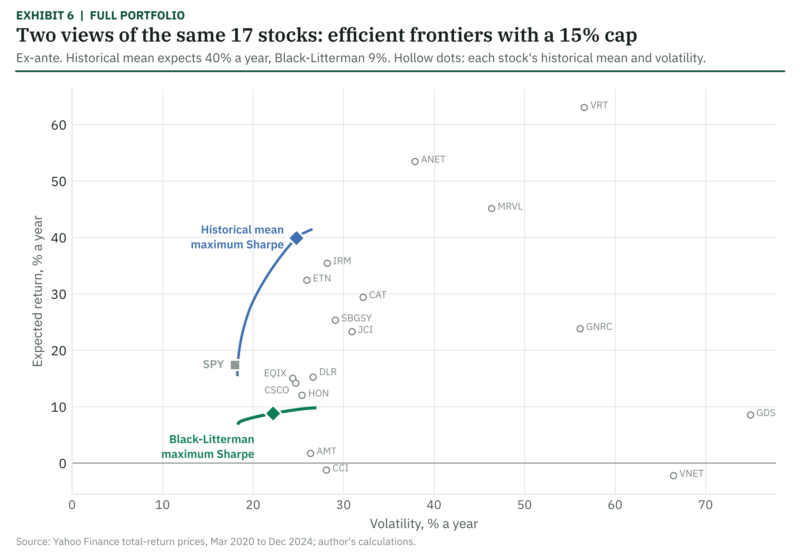

**In-sample performance.** Over March 2020 to December 2024, $500,000 grew to $2.90 million in the historical-mean portfolio, $2.02 million in Black-Litterman and $1.07 million in the S&P 500 (Exhibits 7 and 8). The Sharpe ratios tell the more interesting story. The historical-mean portfolio expected a Sharpe ratio of 1.51 and delivered 1.55, an almost perfect forecast, because it was scored on the data that produced the forecast. Black-Litterman expected 0.29 and delivered 1.33. Its expectations were modest, and 2020 to 2024 was an unusually good period for the theme. In sample, a small gap between expected and delivered performance is a warning sign.

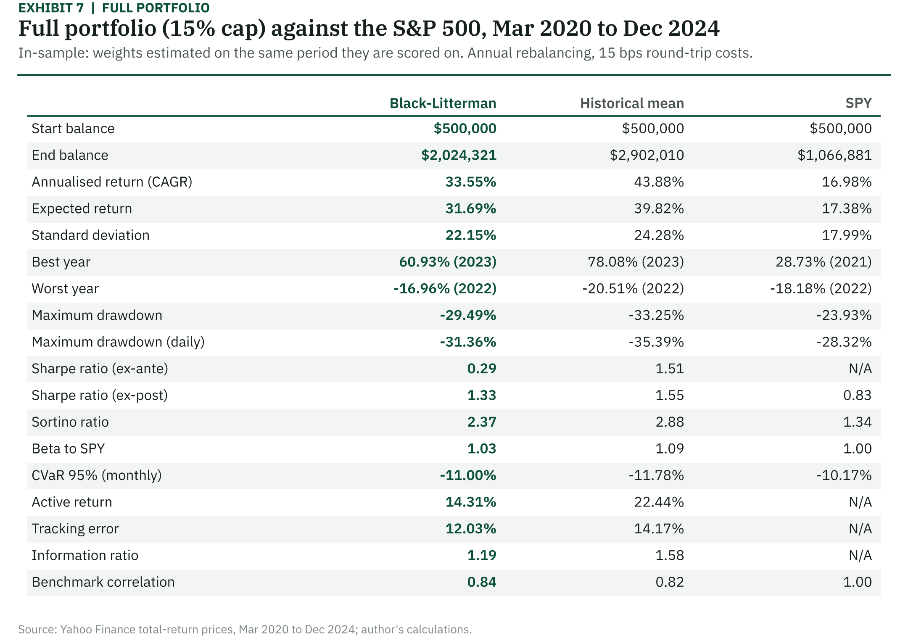

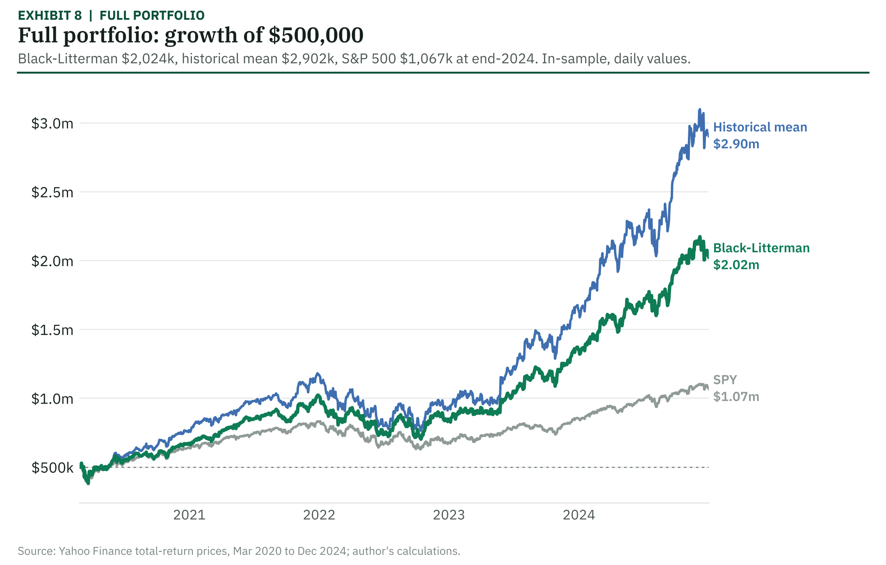

# 4. Out of sample

**Design.** We fixed the design before looking at any results. The portfolios are formed with data up to 31 December 2024, held at those target weights, rebalanced once a year back to the same targets, and scored from January 2025 to September 2026: 21 months. The comparison set was fixed in advance as well: the S&P 500 as the benchmark, the two thematic ETFs, and an equally weighted portfolio of the seventeen stocks. The last one is the test of whether optimisation adds anything at all. DeMiguel, Garlappi and Uppal (2009) found that optimised portfolios rarely beat it out of sample. Exhibit 9 reports the results.

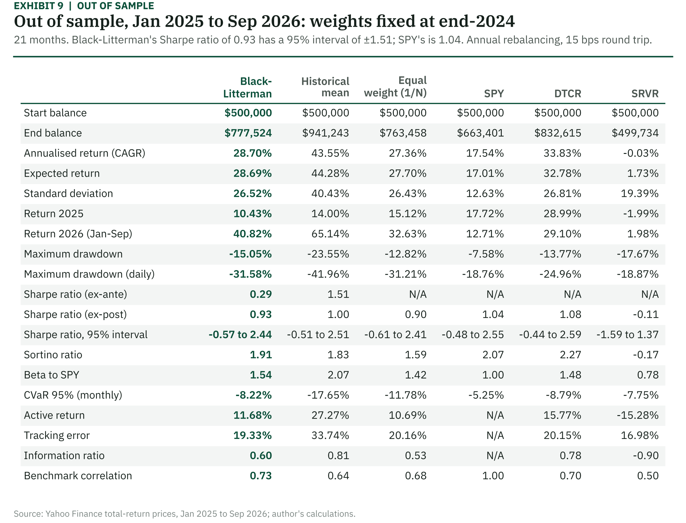

**What 21 months can say.** Every Sharpe ratio in Exhibit 9 carries a 95% interval of about ±1.5 (Lo, 2002), so no portfolio can be distinguished from another or from the market. The instability shows directly. An interim check on the first 14 months ranked the historical-mean portfolio last of the four, with a Sharpe ratio of 0.88. Seven months later it ranks above Black-Litterman, 1.00 against 0.93. A ranking that reverses with seven more months of data is mostly noise.

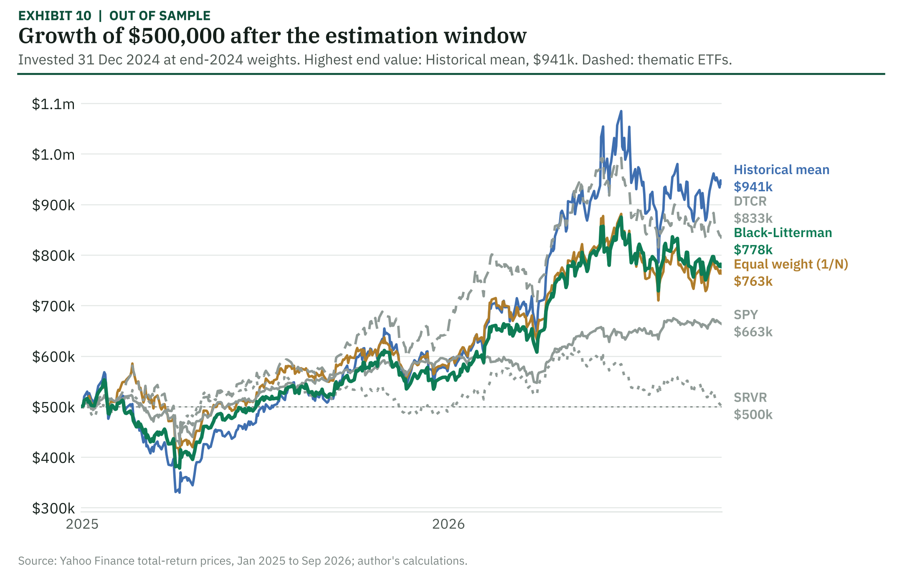

**Where the money came from.** The historical-mean portfolio earned the most, $941,000 from $500,000 (Exhibit 10), but with a beta of 2.07 to the S&P 500, a 42% fall from peak to trough in April 2025 (Exhibit 11), and twice the monthly tail loss of Black-Litterman. It behaved like a geared bet on the theme, and the 2026 rally rewarded it. The passive ETF DTCR had the highest Sharpe ratio in the table (1.08, ending at $833,000), though with intervals of ±1.5 that ranking means as little as the others. SRVR, the REIT ETF, ended flat, in line with the tower REITs separating from the rest of the theme after 2024 (Exhibit B3).

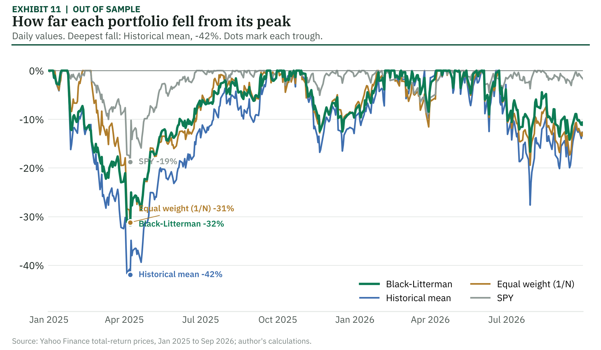

**What the optimiser added.** Black-Litterman and the equally weighted portfolio ended within 2% of each other, $778,000 against $763,000, with almost the same volatility, drawdown and Sharpe ratio. Over this window the views and the optimiser added little beyond holding the seventeen stocks in equal amounts. That is the usual out-of-sample result for mean-variance methods, and we report it as a finding of this note.

**The forecast that can be tested.** Exhibit 12 sets each forecast against the outcome and the outcome's own sampling error. The realised return of each portfolio has an interval of ±40 to ±60 percentage points, wide enough to contain every return forecast, including Black-Litterman's 9% against the 29% it delivered. Volatility is estimated far more precisely, and there the methods differ. Black-Litterman forecast 22% a year and realised 26.5%, inside the interval. The historical-mean portfolio forecast 25% and realised 40%, outside it. Shrinking the covariance matrix and anchoring expected returns to the market produced a risk forecast an investor could have planned around. Optimising on sample means produced one that understated risk by more than a third. We chose this comparison after seeing the results, and we report it with that caveat. It is still a test the data can decide, which the return comparison is not.

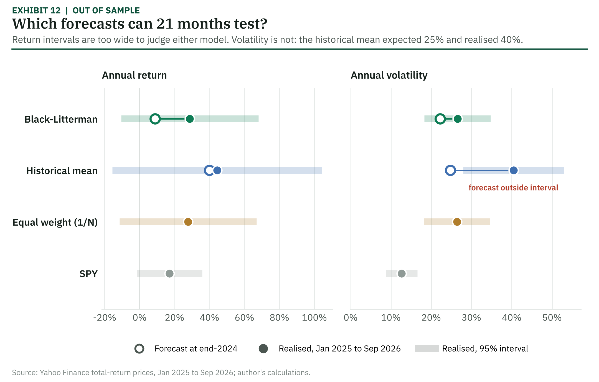

# 5. Ten-year outlook

**Model.** Each stock's monthly return is its expected return plus its own volatility times a fat-tailed shock: a Student-t variable, with degrees of freedom fitted to that stock's history and rescaled to unit variance. The shocks are tied together by a Student-t copula (Demarta and McNeil, 2005), whose correlation is the shrunk correlation from Section 2 and whose degrees of freedom (12) are estimated by maximum likelihood. Unlike a normal simulation, this gives joint crashes a realistic probability. All risk parameters use every month from March 2020 to September 2026. The portfolios keep their end-2024 weights, are rebalanced once a year at 15 basis points, and start from $500,000 on 30 September 2026. End values are deflated by 2.6% a year, the average US inflation rate of the last 30 years. The same 10,000 simulated paths of shocks are used for every portfolio and every scenario, so any difference between two scenarios comes from their inputs.

**The expected return is an assumption.** Section 4 showed that 21 months cannot test a return forecast, and the 79 months behind this simulation cannot pin one down either. We therefore run the projection under four assumptions: the Black-Litterman posterior, the market equilibrium without views, the historical mean, and the risk-free rate alone. Everything else is held fixed. Exhibit 13 shows the range of outcomes for the Black-Litterman portfolio under its own assumption, with the median under each of the others.

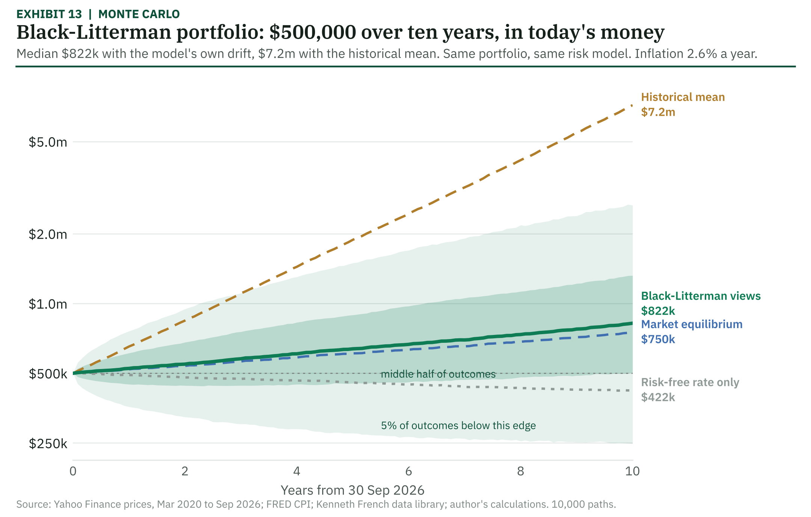

**What decides the answer.** For the Black-Litterman portfolio, the probability of being worth less in ten years than today runs from 0% under the historical-mean assumption to 46% under the risk-free assumption, and its median value in today's money from $422,000 to $7.2 million (Exhibit 14). Feeding a 31% to 41% historical return into a simulation reproduces the first version's near-certain gain. Under its own Black-Litterman assumption, the portfolio has a median of $822,000 in today's money, a 15% chance of a nominal loss, a 25% chance of losing to inflation, and a typical worst fall of about 40% somewhere along the way.

**What does not.** Replacing the t-copula with a normal one changes the ten-year probability of a loss from 15.4% to 15.3%. Fat tails matter at short horizons, where a month worse than −20% is about three times as likely under the t-copula. Over ten years, 120 monthly returns across seventeen stocks average out, and the expected-return assumption outweighs everything else in the model. The effort a projection deserves belongs in that assumption, the input that is hardest to estimate.

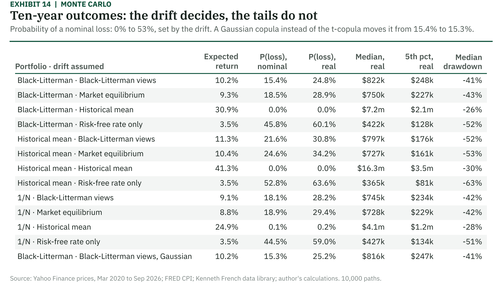

# 6. Risks to the thesis

These are the risks the analysis itself points to, each with the place in the note where it shows.

**One cluster carries the portfolio.** Infrastructure suppliers make up 69% of the Black-Litterman portfolio and 75% of the historical-mean portfolio (Exhibit 5). In practice both are a position in the companies that sell equipment into new data centres, and a slowdown in that spending would reach most of the portfolio at once.

**The market comes with it.** Out of sample, Black-Litterman had a beta of 1.54 to the S&P 500 and the historical-mean portfolio 2.07 (Exhibit 9). Black-Litterman lost 32% from peak to trough and the historical-mean portfolio 42%. Both bottomed on 8 April 2025, the same day as the S&P 500, which was down 19% (Exhibit 11). Held next to an index fund, the theme adds to market risk more than it diversifies it.

**Hindsight in the universe.** The seventeen names were chosen in 2025, when the winners of the AI build-out were already visible. A universe chosen in 2020 could have looked different. This is survivorship in the choice of stocks, and it flatters every in-sample result. Because the first version was written in August 2025, it touches part of the out-of-sample window too. Of all the risks here, it is the one most likely to make the theme look better than it was.

**The return assumption.** Under the four assumptions in Section 5, the Black-Litterman portfolio's chance of a nominal loss over ten years runs from 0% to 46% (Exhibit 14). The views behind the posterior are our judgement, and the 5.5% market premium in the prior is an assumption no one can measure precisely.

**Thin evidence.** The estimation window has 58 months and the out-of-sample window 21. With Sharpe ratio intervals of ±1.5, nothing in this note shows one method beating another on return. The estimation window was also an unusually good period for the theme, and correlations changed after it: the average fell from 0.35 to 0.24, and the tower REITs separated from the rest (Exhibit B3). Weights estimated in one regime are being held through the next.

**The prior measures size, not exposure.** Cisco, Honeywell and Caterpillar make up 28% of the Black-Litterman portfolio because they are large companies, not because data centres are a large part of their business (Section 3). If the theme does well and the rest of their business does not, the portfolio captures less of it than its label suggests.

**China listing risk.** Portfolios of GDS and VNET fell 96% from peak to trough in sample (Appendix A). The covariance matrix sees their volatility but not the regulatory, listing and funding risks behind it. The historical-mean portfolio holds 6% in GDS. Black-Litterman holds none: GDS starts with a tiny market weight, and our view against it pushes the weight lower.

# 7. Conclusions and next steps

The investment case for data centres was right over this period, and the companies that supply the buildings carried it. The case for optimising the portfolio is weaker. Optimising on historical returns looks impressive in sample because it is scored on its own inputs. Out of sample its returns were the highest, but so was its risk, and its risk forecast missed by more than a third. Black-Litterman produced a diversified portfolio with a believable risk forecast, and returns that could not be told apart from an equally weighted basket of the same stocks. Over 21 months, no method could be told apart from the market on a risk-adjusted basis.

For an investor, three things follow. A simple equal-weighted basket of the infrastructure names, or a thematic ETF such as DTCR, captured most of what the optimised portfolios captured. A position cap is worth more than it costs. And any projection of this portfolio stands or falls on its expected-return assumption, which should be shown as a range.

**Next steps.** Four extensions would make the analysis stronger. A theme-exposure prior would anchor Black-Litterman to data-centre revenue instead of company size. Re-estimating the weights each year on an expanding window would turn the single out-of-sample test into a sequence of them. A longer history, or a wider universe including European and Asian listings, would narrow the intervals that currently decide most of the conclusions. And cluster bands set from a real mandate would show how much of the portfolio's behaviour comes from judgement and how much from the optimiser.

# Appendix A. Cluster portfolios

Before optimising the full universe, we optimised inside each cluster, on the estimation window only and without a position cap. These results are in sample. They are here because they show, three times over, the pattern Section 3 describes.

**REITs.** The historical-mean optimiser puts 100% in Iron Mountain (Exhibits A1 to A3), the best performer of 2020 to 2024. Black-Litterman spreads across all five: 31% Iron Mountain, 23% Equinix, 22% American Tower, 15% Digital Realty and 10% Crown Castle. $500,000 in the historical-mean portfolio grew to $2.25 million in sample. The Black-Litterman portfolio grew to $1.02 million, close to the S&P 500's $1.07 million, with a lower beta of 0.86.

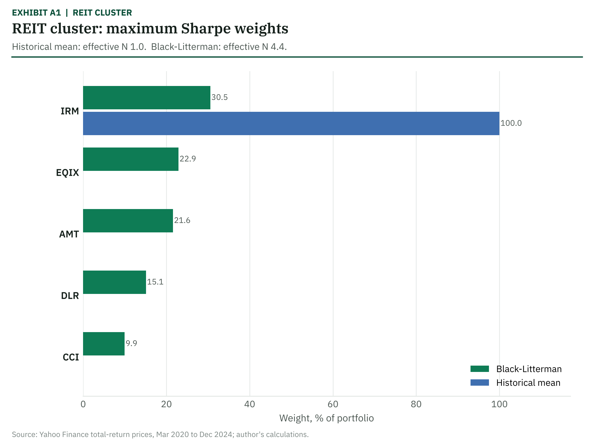

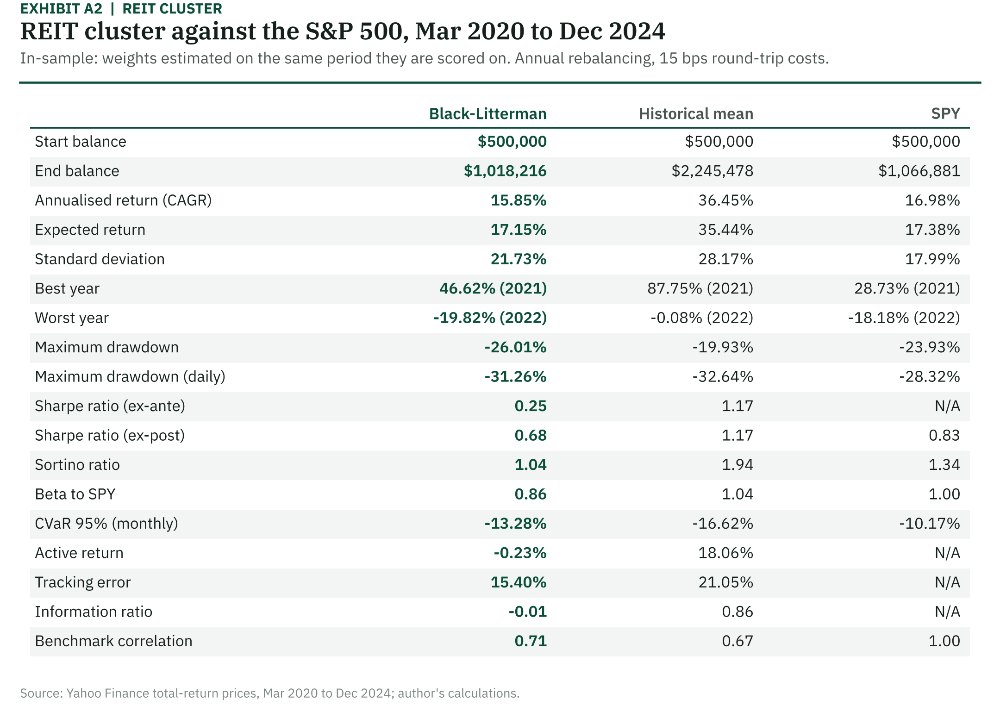

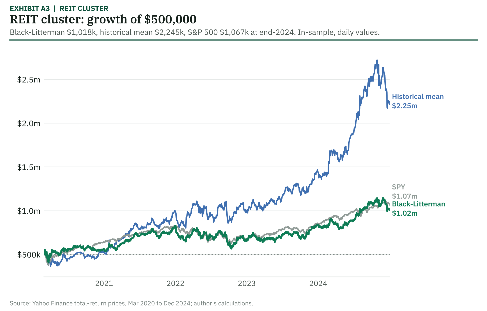

**Asia.** With two stocks and full investment required, neither method can diversify (Exhibits A4 to A6). The historical mean holds only GDS, and Black-Litterman holds 78% GDS and 22% VNET. Both portfolios fell 96% from peak to trough and turned $500,000 into about $205,000 to $208,000. We keep this cluster in the note as a reminder that a theme and the shares used to hold it are two different things.

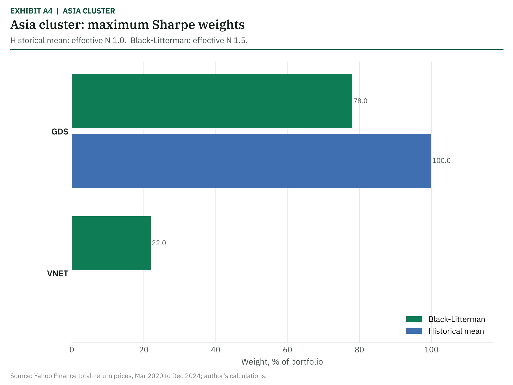

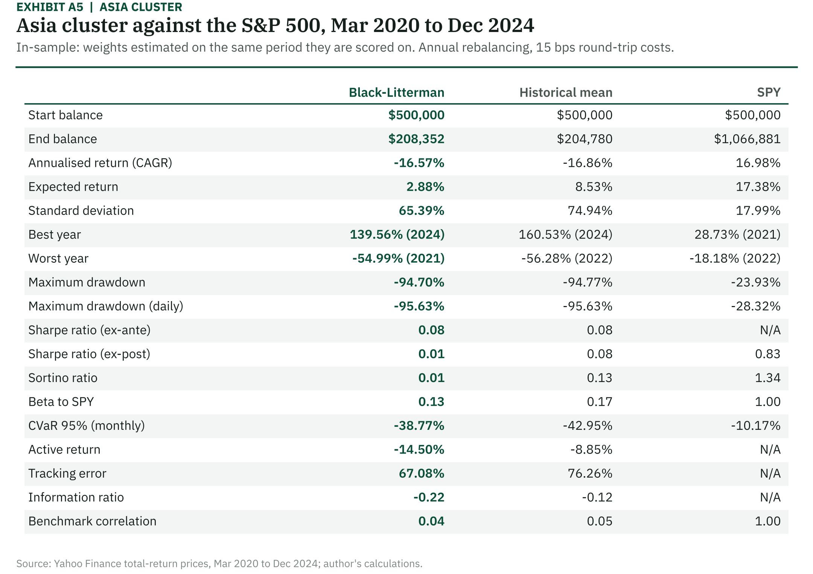

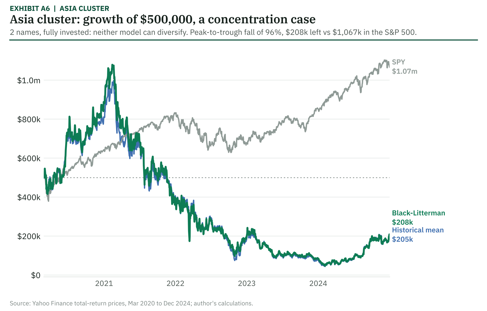

**Infrastructure.** This is where the theme paid (Exhibits A7 to A9). The historical mean puts 49% in Arista and most of the rest in Eaton, Vertiv and Caterpillar, and grows $500,000 to $3.76 million. Black-Litterman holds all ten names, with Arista at 28% and Cisco at 14%, and grows it to $2.61 million with an ex-post Sharpe ratio of 1.40.

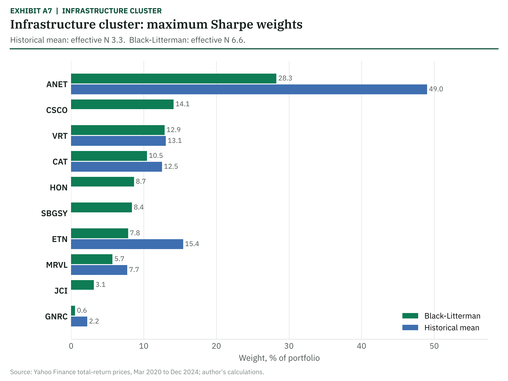

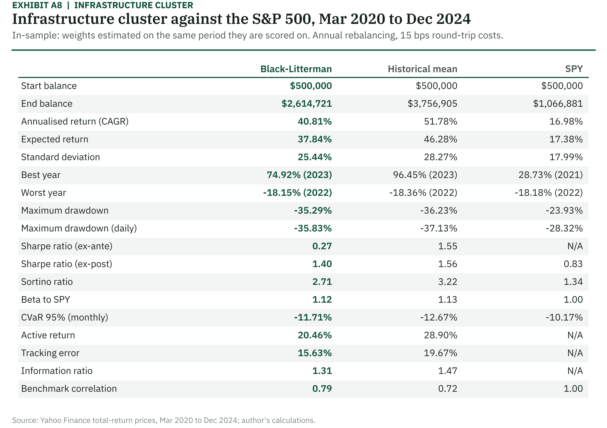

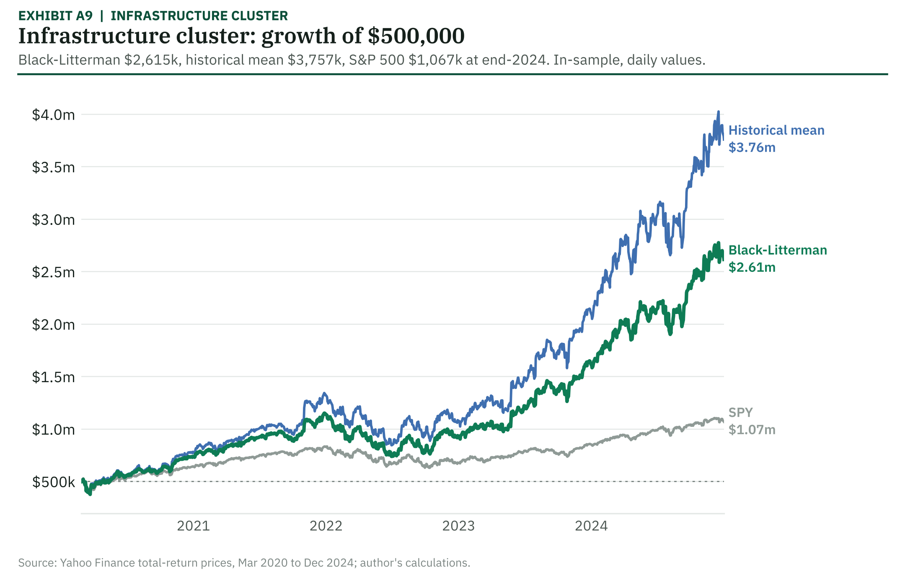

The pattern is the same in every cluster. The historical mean concentrates in the past winner and looks better in sample. Black-Litterman diversifies and looks worse. Section 4 tests which of the two impressions holds.

# Appendix B. Correlation structure

**Do the clusters exist in the data?** We grouped the universe by business line. To test whether returns agree, we cluster the stocks hierarchically on the distance d = √(½(1 − ρ)) between each pair (Mantegna, 1999), using average linkage. We fixed the linkage method before comparing results, because choosing it afterwards would let the answer choose the method. Cutting the tree into three groups (Exhibit B1) and scoring it against the business-line labels with the adjusted Rand index (Hubert and Arabie, 1985), where 1 means identical groupings and about 0 means random ones, gives:

| Linkage | ARI | Groups found |
|---|---|---|
| Single | 0.25 | Generac alone; the Chinese operators; all others |
| Average (used) | 0.25 | Generac alone; the Chinese operators; all others |
| Complete | 0.61 | The Chinese operators; REITs with Generac; infrastructure with Iron Mountain |
| Ward | 0.23 | The Chinese operators; Iron Mountain with the industrials; REITs with Arista, Cisco, Marvell and Generac |
| Shuffled labels, 95th percentile | 0.24 | |

Only one result holds under every method: GDS and VNET form their own group. The split between REITs and infrastructure depends on the method, and under three of the four it is no better than chance. Two stocks explain most of the disagreement. Iron Mountain trades with the infrastructure names more than with the other REITs. Generac sits apart from everything. The business-line clusters are a reasonable way to organise the analysis. They do not describe how the stocks move together.

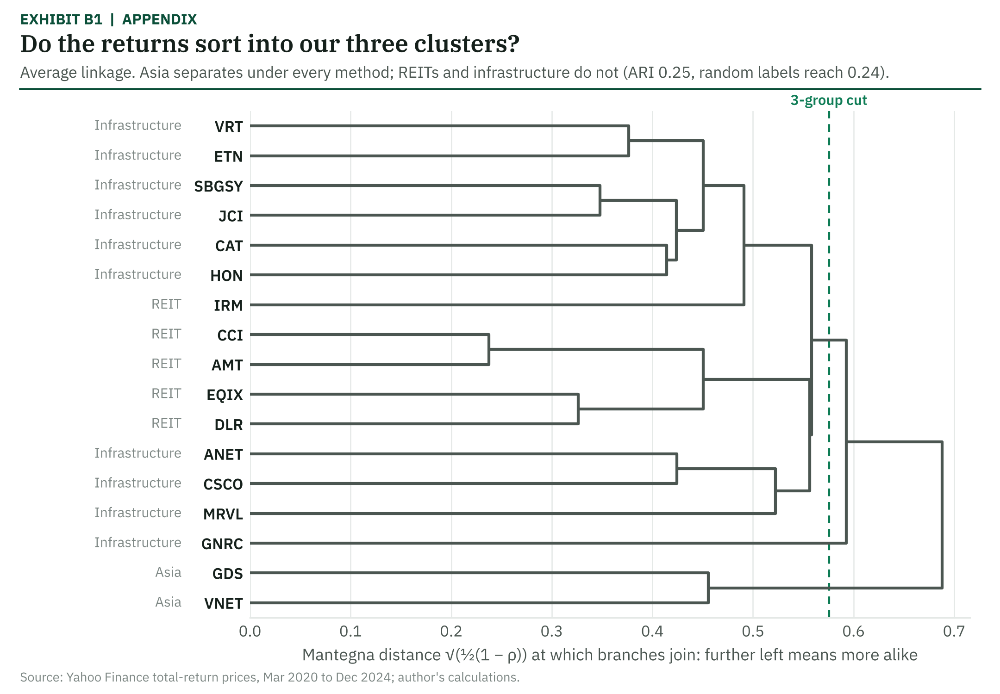

**What shrinkage changes.** The shrinkage intensity is 0.24, so every pairwise correlation moves 24% of the way towards the average correlation of 0.35, and each stock's own variance is unchanged (Exhibit B2). The strongest and weakest pairs move most, which is intended: they are the estimates most likely to be extreme by chance.

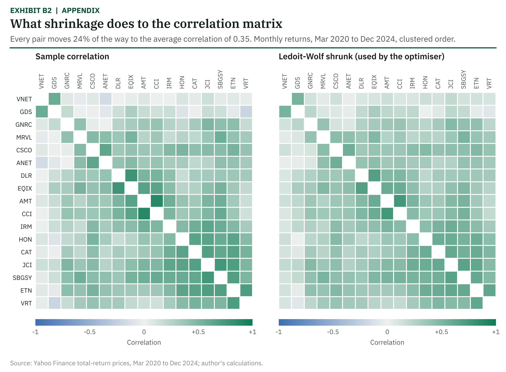

**After 2024.** Exhibit B3 compares correlations in the out-of-sample window with the estimation window. The average correlation fell from 0.35 to 0.24. The tower REITs, American Tower and Crown Castle, separated from almost everything else, while Equinix, Digital Realty and Iron Mountain moved closer to the infrastructure names. Twenty-one months is a short window for seventeen stocks, so we read the direction of these changes and put little weight on their size.

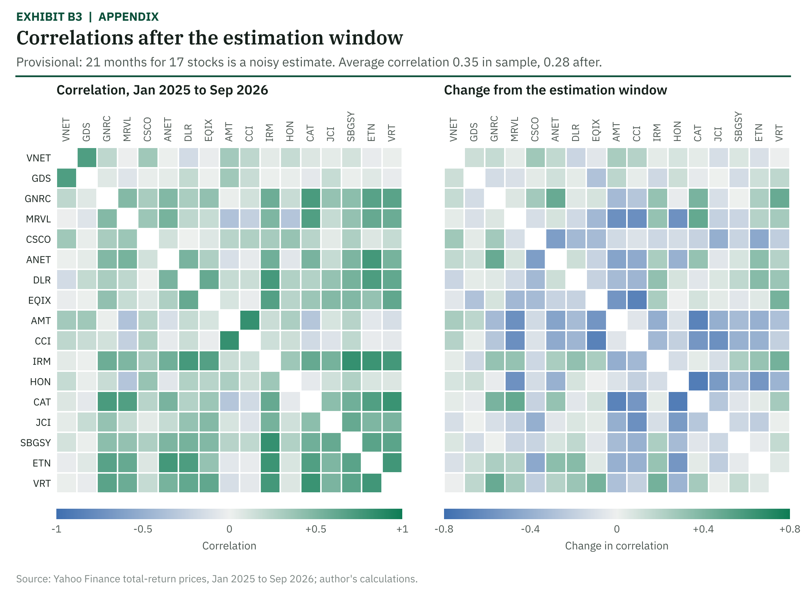

# Appendix C. Methods and measures

**Measures.** Exhibits report the compound annual return, the arithmetic expected return and volatility, maximum drawdown on month-end and on daily values, the Sharpe ratio, the Sortino ratio (Sortino and Price, 1994), beta to the S&P 500, monthly 95% CVaR, and the active return, tracking error and information ratio against the S&P 500 (Grinold and Kahn, 2000).

*Ledoit-Wolf shrinkage.* Σ̂ = δF + (1 − δ)S, where S is the sample covariance and F has the sample variances on the diagonal and r̄·σᵢσⱼ off it, with r̄ the average sample correlation. The intensity δ minimises expected squared error and is estimated from the data.

*Black-Litterman.* Prior Π = λΣw_mkt, with λ set so that the market portfolio earns a 5.5% premium. Views PΠ + q with uncertainty Ω = diag(τPΣPᵀ), τ = 1/T. Posterior mean Π + τΣPᵀ(τPΣPᵀ + Ω)⁻¹q, posterior covariance Σ plus the uncertainty of the mean.

*Maximum Sharpe ratio.* Minimise yᵀΣy subject to (μ − r_f)ᵀy = 1, y ≥ 0 and yᵢ ≤ c·Σⱼyⱼ for a cap c; the weights are w = y / Σy. The problem is convex and has a single optimum.

*Sharpe ratio interval.* For T monthly returns with monthly Sharpe ratio S, the standard error of S is approximately √((1 + S²/2)/T) (Lo, 2002); the annual interval multiplies by √12.

*Monte Carlo.* Monthly return rᵢ = μᵢ/12 + σᵢzᵢ, floored at −95%, with z from a Student-t copula with Student-t marginals rescaled to unit variance. Annual rebalancing, 15 basis points per round trip, 10,000 paths, fixed seed.

# Appendix D. Data, reproducibility and version history

**Data.** Prices: Yahoo Finance through the yfinance library, daily, adjusted for dividends and splits. Risk-free rate: Kenneth R. French data library. Inflation: FRED series CPIAUCSL. Market capitalisations: Yahoo Finance share counts and unadjusted closing prices on 31 December 2024, cross-checked against separately compiled reference figures (all within 3%).

**Reproducibility.** The code is published with this note. `scripts/refresh_data.py` downloads a new snapshot, and `scripts/build_exhibits.py` rebuilds every exhibit and every CSV of underlying numbers from it. Two builds from the same snapshot produce identical numbers. The price data are not redistributed with the code; anyone running it downloads their own copy. Results from a later snapshot will differ slightly because the providers revise their histories.

**Changes from the first version.** The first version used Portfolio Visualizer for every optimisation, chart and simulation, and its exhibits were screenshots. Going back through them showed four problems serious enough to warrant starting over.

The estimation windows did not match. The text described the analysis as covering 2019 to 2024, but the cluster optimisations used windows of 9.6, 8.6, 6.6, 4.6 and 4.6 years, so the clusters were not comparable with each other or with the full portfolio. The portfolios were scored on the same data their weights were estimated from, which guarantees an attractive backtest and says nothing about the future. Vertiv's price history before February 2020 belonged to the shell company it merged with to list, not to Vertiv. And the Monte Carlo fed historical average returns of up to 70% a year into a simulation and reported a 38% expected return with no chance of loss. That number reflects the inputs the simulation was given.

This version fixes those in the following ways. Everything is computed from one data snapshot, on one estimation window, by code that rebuilds every exhibit and number in this note in one run. Results are reported twice: in sample, where they show what each method chose and why, and out of sample, where they show what happened next. The simulation treats the expected return as an assumption to vary. All exhibits are our own.

# References

Black, F. and Litterman, R. (1992). Global portfolio optimization. *Financial Analysts Journal*, 48(5), 28 to 43.

DeMiguel, V., Garlappi, L. and Uppal, R. (2009). Optimal versus naive diversification: how inefficient is the 1/N portfolio strategy? *Review of Financial Studies*, 22(5), 1915 to 1953.

Demarta, S. and McNeil, A. J. (2005). The t copula and related copulas. *International Statistical Review*, 73(1), 111 to 129.

Grinold, R. C. and Kahn, R. N. (2000). *Active Portfolio Management*, 2nd edition. McGraw-Hill.

He, G. and Litterman, R. (1999). The intuition behind Black-Litterman model portfolios. Goldman Sachs Investment Management Research.

Hubert, L. and Arabie, P. (1985). Comparing partitions. *Journal of Classification*, 2, 193 to 218.

Jagannathan, R. and Ma, T. (2003). Risk reduction in large portfolios: why imposing the wrong constraints helps. *Journal of Finance*, 58(4), 1651 to 1683.

Ledoit, O. and Wolf, M. (2004). Honey, I shrunk the sample covariance matrix. *Journal of Portfolio Management*, 30(4), 110 to 119.

Lo, A. W. (2002). The statistics of Sharpe ratios. *Financial Analysts Journal*, 58(4), 36 to 52.

Mantegna, R. N. (1999). Hierarchical structure in financial markets. *European Physical Journal B*, 11, 193 to 197.

Michaud, R. O. (1989). The Markowitz optimization enigma: is "optimized" optimal? *Financial Analysts Journal*, 45(1), 31 to 42.

Sortino, F. A. and Price, L. N. (1994). Performance measurement in a downside risk framework. *Journal of Investing*, 3(3), 59 to 64.

Disclaimer

This note is a personal research project, written for learning and discussion. It is not investment advice, and it is not an offer or a recommendation to buy or sell any security. Past returns, in sample or out of sample, do not predict future returns. The figures are computed from public data that may contain errors, and the simulations rest on assumptions stated in the text.

